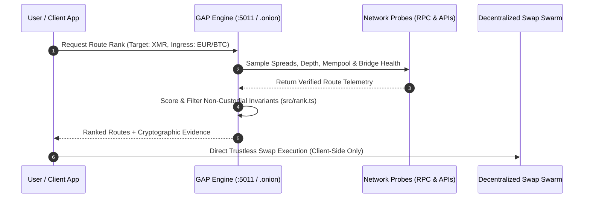

# GAP — Sovereign Non-Custodial Gateway & Routing Engine

> **Autonomous Read-Only Intelligence Desk for Compliant Ingress & Non-Custodial Monero Settlement.**

[](http://2kj2ucj3m7w7d2ve6cgdj2nwzoxc4dynsk43hpdlt2oycntq4czg3dqd.onion/)
[](https://vps3273531.tailb6faa1.ts.net/desk)
[](LICENSE)
[](#what-gap-is-not)

---

## 🧭 Executive Summary

**GAP** is an autonomous, read-only decision and routing engine. It bridges verified regulated on-ramps (e.g., compliant fiat/crypto providers) to sovereign, non-custodial privacy destinations (atomic swap paths into Monero - XMR).

GAP operates under strict cryptographic and read-only constraints: **it never holds private keys, never acts as an intermediary custodian, and never executes fund transactions on behalf of users.** It provides pure algorithmic ranking, verifiable fee quotes, and cryptographic route validation.

```mermaid
flowchart TD
    User["Verified Ingress<br/>(Revolut / Bank / CEX)"] -->|"Compliant Purchase (BTC / LTC)"| CleanAsset["Clean Intermediate Asset<br/>(BTC On-Chain)"]
    CleanAsset -->|"Trustless Atomic Swap<br/>(P2P Submarine / HTLC)"| SovereignXMR["Sovereign Cold Storage<br/>(Monero - XMR)"]
    
    subgraph GAP Engine ["🛡️ GAP Autonomous Desk (Read-Only)"]
        direction TB
        Probe["Live Telemetry Probes<br/>(Liquidity, Fees, Slippage)"] --> Ranking["Deterministic Route Ranker<br/>(src/rank.ts)"]
        Ranking --> Registry["Verifiable Route Registry<br/>(routes.json)"]
        Registry --> UI["Live GAP Desk & Onion API"]
    end
    
    GAP Engine -.->|"Real-Time Route Telemetry & Scoring"| User
```

---

## ⚡ Architecture & How It Works

GAP continuously samples network depth, liquidity spreads, atomic swap rates, and counterparty risks to recommend the optimal trustless route from regulated capital to privacy assets.



---

## 🛡️ Invariants: What GAP Is & What It Is NOT

| Feature | GAP Architecture | Centralized Exchanges / Mixers |
| :--- | :---: | :---: |
| **Custody of Funds** | **0% (Zero)** — Never holds user coins | 100% (Third-party risk) |
| **Private Keys Access** | **None** — Pure client-side signing | Held on remote servers |
| **Anonymizing Mixer** | **No** — Relies on mathematical atomic swaps | Obfuscation pools (Subject to blacklisting) |
| **Regulatory Risk** | **Compliant** — Analytical & routing telemetry | Subject to CASP / AML6 sanctions |
| **Execution Vector** | **Read-Only Desk** | Custodial settlement |

> [!IMPORTANT]
> **Regulatory Perspective (EU Regulation 2024/1624):**  
> Under EU AML package standards (effective July 2027), custodial CASP accounts supporting privacy-enhancing coins are restricted. GAP is architected specifically to prevent custodial intermediation, providing decentralized market intelligence and trustless atomic routing protocols.

---

## 🌐 Live Desk Endpoints

GAP Desk is exposed across dual secure channels:

1. **Tor Hidden Service (Deep Privacy):**  
   🧅 [`http://2kj2ucj3m7w7d2ve6cgdj2nwzoxc4dynsk43hpdlt2oycntq4czg3dqd.onion/`](http://2kj2ucj3m7w7d2ve6cgdj2nwzoxc4dynsk43hpdlt2oycntq4czg3dqd.onion/)  
   *(Accessible via Tor Browser or local SOCKS5 proxy `127.0.0.1:9050`)*

2. **Tailscale Funnel (Authenticated Mesh):**  
   🔒 [`https://vps3273531.tailb6faa1.ts.net/desk`](https://vps3273531.tailb6faa1.ts.net/desk)

3. **Local Loopback Daemon:**  
   💻 `http://127.0.0.1:5011`

---

## 🔌 API Specification

All routes return strictly typed JSON. Failed invariants fail-closed with HTTP `400 Bad Request`.

### `GET /healthz`
Health status of the GAP desk and active network probes.
```json
{
  "status": "ok",
  "uptime": 12840,
  "service": "gap-desk",
  "tor_online": true
}
```

### `POST /api/rank`
Ranks and evaluates routing paths based on latency, liquidity score, and non-custodial constraints.
```bash
curl -X POST http://127.0.0.1:5011/api/rank \
  -H "Content-Type: application/json" \
  -d '{"ingress": "BTC", "target": "XMR", "amount": 0.05}'
```

### `GET /api/registry`
Returns the verified list of mathematical atomic swap providers and on-chain liquidity stamps.

---

## 🚀 Development & Local Execution

### Prerequisites
- Node.js >= 20.x or modern ESM runtime
- Local Tor Daemon (optional, for `.onion` broadcast)

```bash
# Clone the repository
git clone https://github.com/valentinuuiuiu/gap.git
cd gap

# Run tests
npm test

# Launch the live Desk locally (Port 5011)
node --experimental-strip-types scripts/desk-server.mjs
```

---

## 📜 Sovereign Guarantee
**Rezultatul e singurul judecător.** GAP code is designed to remain verifiable, deterministic, and autonomous. No tracking, no custody, no telemetry leaks.
